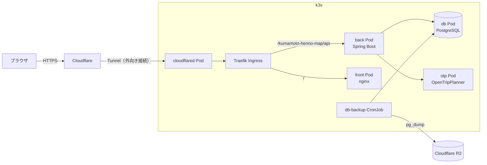

# k3s（自宅サーバー）デプロイ手順

自宅サーバー1台に k3s を構築し、Helm チャート `deploy/helm/kumamoto-henno-map` でアプリ一式をデプロイする手順です。

## 構成



| コンポーネント | リソース | イメージ |
|---|---|---|
| front | Deployment | `ghcr.io/taichi0373/kumamoto-henno-map-front`（`apps/front/Dockerfile`） |
| back | Deployment | `ghcr.io/taichi0373/kumamoto-henno-map-back`（`apps/back/Dockerfile`） |
| otp | Deployment | `ghcr.io/taichi0373/kumamoto-henno-map-otp`（`config/otp/Dockerfile`、graph.obj 同梱） |
| db | StatefulSet + PVC | `postgres:18` |
| cloudflared | Deployment | `cloudflare/cloudflared` |

- front と back は Ingress のパス振り分けで**同一オリジン**として公開する（Vercel の rewrites と同じ役割）。HttpOnly Cookie によるリフレッシュトークンがそのまま機能する。
- TLS は Cloudflare で終端するため、クラスタ内は HTTP。
- イメージは `main` へのマージ時に `.github/workflows/publish-images.yml` がビルドし、コミット SHA と `latest` のタグで GHCR に push する。

## 推奨スペック

| 項目 | 目安 |
|---|---|
| メモリ | 8GB 以上（OTP 4GB + back 1GB + その他） |
| ストレージ | 20GB 以上 |
| OS | Ubuntu 24.04 LTS |

## 1. k3s のインストール

```bash
curl -sfL https://get.k3s.io | sh -
# 一般ユーザーで kubectl を使う
mkdir -p ~/.kube && sudo cp /etc/rancher/k3s/k3s.yaml ~/.kube/config && sudo chown $USER ~/.kube/config
kubectl get nodes
```

Helm のインストール:

```bash
curl -fsSL https://raw.githubusercontent.com/helm/helm/main/scripts/get-helm-3 | bash
```

## 2. Traefik の転送ヘッダー設定

cloudflared から届く `X-Forwarded-For` を信頼させる（ログイン試行制限をクライアント IP 単位で正しく働かせるため）。

```bash
kubectl apply -f deploy/k3s/traefik-config.yaml
```

> back は `FORWARD_HEADERS_STRATEGY=NATIVE`（Tomcat RemoteIpValve）で動かす。`X-Forwarded-For` を右から辿り、内部アドレス（10.x 等）を除いた最初の IP をクライアント IP とするため、クライアントが先頭に偽装値を入れても影響を受けない。

## 3. Cloudflare Tunnel の作成

1. Cloudflare Zero Trust → **Networks** → **Tunnels** → **Create a tunnel**（種類: Cloudflared）
2. 表示されたインストールコマンドの `--token` 以降（`eyJ...`）を控える → `deploy/.env` の `CLOUDFLARED_TOKEN` に設定（コマンド自体は実行しない）
   - コネクタが接続されるまでウィザードの次へ進めないため、先に `CLOUDFLARED_TOKEN` を設定してデプロイし、cloudflared Pod を起動する
3. トンネルの **Routes** → **Add route** → **Published application** でホスト名を追加
   - `www.kumamoto-henno-map.com` → `HTTP` / `traefik.kube-system.svc.cluster.local:80`
   - `kumamoto-henno-map.com` → 同上
4. 既存の Vercel / Render 向け DNS レコードは、切り替えのタイミングで削除する（Tunnel 側が CNAME を作成する）

## 4. 設定ファイルの準備

設定は2種類に分けて管理する。

| ファイル | 内容 | Git 管理 |
|---|---|---|
| `deploy/.env` | DB の接続先、秘密情報、イメージタグ、使用する values ファイル | 管理外 |
| `deploy/helm/kumamoto-henno-map/values-*.yaml` | 環境ごとの構成（ホスト名、メモリ、イメージの取得方法など） | 管理する |

```bash
cp deploy/.env.example deploy/.env
vi deploy/.env                                      # 各項目のコメントを参照して設定
vi deploy/helm/kumamoto-henno-map/values-home.yaml  # ホスト名・メモリなど
```

> `deploy/.env` はシェルとして実行せず `KEY=VALUE` として読み込むため、値に `$` や記号を含んでもよい。空欄の項目は values ファイルの値が使われる。

GHCR のパッケージが非公開の場合は、pull 用の Secret を作成して `global.imagePullSecrets` に指定する。

```bash
kubectl create namespace khm
kubectl -n khm create secret docker-registry ghcr \
  --docker-server=ghcr.io --docker-username=<GitHubユーザー> --docker-password=<read:packages の PAT>
```

## 5. デプロイ

```bash
bash deploy/scripts/deploy.sh          # helm upgrade --install を実行
kubectl -n khm get pods -w
```

`deploy.sh` は `deploy/.env` を読み込み、DB 初期化 SQL のコピー（`sync-db-files.sh`）を行ってから Helm を実行する。秘密情報はコマンドライン引数ではなく標準入力で Helm に渡すため、`ps` 等で見えることはない。

> `IMAGE_TAG` は必須。`latest` を使うと、ノードに残っている古いイメージがそのまま使われて更新が反映されないため、`publish-images.yml` が付与するコミット SHA を指定する。一時的に変える場合は `IMAGE_TAG=<SHA> bash deploy/scripts/deploy.sh` のように環境変数で上書きできる。

> 初回デプロイで DB の初期化が終わったら、`values-home.yaml` で `db.initSchema: false` に切り替えることを推奨する。`true` のままだと、SQL ファイルを追加・削除したときに DB Pod が再起動する。

デプロイ前の確認には次を使う。

```bash
bash deploy/scripts/deploy.sh lint
bash deploy/scripts/deploy.sh template | less
```

ロールバック:

```bash
helm history khm -n khm
helm rollback khm <REVISION> -n khm
```

## 6. Supabase からの段階的な移行

| ステップ | 設定（`deploy/.env` / values） | 内容 |
|---|---|---|
| 1 | `DB_ENABLED=false`、`EXTERNAL_DB_HOST` / `EXTERNAL_DB_USERNAME` / `DB_PASSWORD` に Supabase の Session pooler の情報 | Supabase に接続したまま、front / back / otp / cloudflared を自宅で稼働させる |
| 2 | `DB_ENABLED=true`、values で `db.initSchema: false` | 自宅の DB を空で起動し、Supabase のダンプをリストアする（下記） |
| 3 | — | 動作確認後に Supabase を停止する |

ステップ1の注意:

- Supabase の直接接続ホスト（`db.xxxxx.supabase.co`）は IPv6 専用のため、k3s の Pod（IPv4）からは接続できない。ダッシュボードの **Connect** → **Session pooler** のホスト（`aws-0-<region>.pooler.supabase.com`）とユーザー名（`postgres.<project-ref>`）を使う。
- back はトークン有効期限等を `LocalDateTime.now()` で記録・比較するため、同じ DB を使う Render とタイムゾーンを揃える（Render は TZ 未設定 = UTC のため、values で `back.timeZone: UTC`）。
- `ADMIN_*` を設定すると、起動時に本番 DB の管理者ユーザーを作成・上書きするため、共有中は設定しない。
- Session pooler は全クライアント合計の同時接続数に上限がある（無料プランは 15）。back の HikariCP は既定で最大 10 接続を保持するため、Render と共有する間は values で `back.dbMaxPoolSize` を小さく（例: 2）する。上限に達すると `EMAXCONNSESSION` で接続できなくなり、本番側にも影響する。
- 本番と共有する DB には、本番と同じバージョンのアプリをつなぐ。リリース前（develop）のコードは、DB のスキーマが合わずに起動に失敗したり、未リリースの機能（例: 本人確認の定期削除）が本番データに作用したりする。

ステップ2のリストア手順:

```bash
# Supabase からダンプ（ローカル PC 等で実行）
pg_dump "postgresql://postgres:<PW>@db.xxxxx.supabase.co:5432/postgres?sslmode=require" \
  -Fc --no-owner --no-privileges -n public -f supabase.dump

# 自宅 DB へリストア
kubectl -n khm cp supabase.dump khm-db-0:/tmp/supabase.dump
kubectl -n khm exec -it khm-db-0 -- \
  pg_restore -U app -d kumamoto_henno_map --no-owner --no-privileges /tmp/supabase.dump
```

> `db.initSchema=true` のまま起動すると、DDL / DML によるテーブル作成とリストアが衝突する。新規構築（データ移行なし）の場合だけ `true` にする。
> 初期化 SQL が実行されるのは**データディレクトリが空のとき（PVC の初回作成時）だけ**。既存の DB へのスキーマ変更は、従来どおり `config/database/ALT/` の SQL を手動で適用する。

## 7. 秘密情報の変更

| 変更する値 | 手順 |
|---|---|
| `DB_PASSWORD`（クラスタ内 DB） | `POSTGRES_PASSWORD` が使われるのは DB の初回作成時だけなので、Secret を変えても DB 側のパスワードは変わらない。先に DB 側を変更してから `deploy.sh` を実行する（back は自動で再起動される）<br>`kubectl -n khm exec -it khm-db-0 -- psql -U app -d kumamoto_henno_map -c "ALTER USER app PASSWORD '<新PW>';"` |
| `CLOUDFLARED_TOKEN` | `deploy.sh` 実行後に `kubectl -n khm rollout restart deployment/khm-cloudflared` |
| 上記以外 | `deploy/.env` を変更して `deploy.sh` を実行するだけでよい（back は checksum の変化で自動的に再起動される） |

## 8. バックアップ（Cloudflare R2）

1. Cloudflare ダッシュボード → **R2** でバケット `kumamoto-henno-map-backup` を作成
2. **Manage R2 API Tokens** で、対象バケットにオブジェクトの読み書き権限を持つトークンを発行
3. `deploy/.env` に以下を設定して `deploy.sh` を実行

```dotenv
DB_BACKUP_ENABLED=true
R2_ENDPOINT=https://<ACCOUNT_ID>.r2.cloudflarestorage.com
R2_ACCESS_KEY_ID=...
R2_SECRET_ACCESS_KEY=...
```

毎日 3:00（JST）に `pg_dump -Fc` を実行し、30 日を過ぎたダンプは削除する。手動実行:

```bash
kubectl -n khm create job --from=cronjob/khm-db-backup khm-db-backup-manual
```

## 9. GTFS 更新時の流れ

1. `gtfs-auto-update.yml` が GTFS 更新 PR を作成 → develop へマージ
2. リリースで main へマージ → `publish-images.yml` が graph.obj を再ビルドし、OTP イメージを push
3. `deploy/.env` の `IMAGE_TAG` を新しい SHA に変えて `bash deploy/scripts/deploy.sh` で反映（OTP は `Recreate` 戦略のため、数分間経路検索が停止する）
