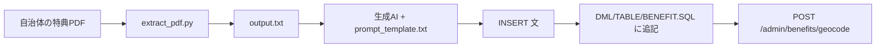

# PDF特典抽出ツール

自治体が公開する特典一覧PDFからテキストを抽出し、`BENEFIT` テーブルへの INSERT 文を生成するための補助ツールです。PDFのテキスト抽出・ノイズ除去をスクリプトで行い、SQL への変換は Claude.ai などの生成AIにプロンプトテンプレートを渡して行います。

## 構成

| ファイル | 内容 |
|---------|------|
| `tools/extract_pdf.py` | PDFからページごとにテキストを抽出し、ヘッダー・フッター・ページ番号を除去して保存する |
| `tools/prompt_template.txt` | 抽出テキストから INSERT 文を生成させるためのプロンプト（カテゴリコード表・自治体コード表を含む） |
| `tools/requirements.txt` | 依存パッケージ（`pdfplumber` / `pytest`） |
| `tools/tests/test_extract_pdf.py` | ノイズ除去・テキスト抽出のユニットテスト |

## セットアップ

Python 3.9 以上が必要です。

```bash
cd tools
python -m venv .venv
source .venv/bin/activate   # Windows: .venv\Scripts\activate
pip install -r requirements.txt
```

## 使い方

```bash
python extract_pdf.py <PDFファイルのパス> [-o 出力ファイル] [--force]
```

| オプション | 説明 | デフォルト |
|-----------|------|-----------|
| `pdf_path` | 抽出するPDFファイルのパス | （必須） |
| `-o`, `--output` | 出力ファイルのパス | `output.txt` |
| `--force` | 出力ファイルが既に存在する場合も上書きする | 上書きしない |

### ノイズ除去のルール

- 数字のみ（`1`）、ダッシュ付き（`- 1 -`）、日本語形式（`第1ページ`）の行はページ番号として除去する
- 2ページ以上ある場合、ページ数の半分以上（最低2回）に出現する行はヘッダー・フッターとして除去する
- 空ページは無視し、ページ間は空行で区切る

## 特典データ登録の流れ



1. `extract_pdf.py` で PDF からテキストを抽出する
2. `prompt_template.txt` の `[採番開始ID]` を現在の最大ID+1 に書き換える（`SELECT MAX(BENEFIT_ID) FROM BENEFIT;` で確認）
3. プロンプトと `output.txt` の内容を生成AIに渡し、INSERT 文を生成させる
4. 生成された SQL を確認し、`config/database/DML/TABLE/BENEFIT.SQL` に追記する（既存DBには手動で適用する）
5. 店舗特典（カテゴリ `BS001`）がある場合は、管理者APIの `POST /admin/benefits/geocode` で住所・緯度経度を取得する（[API仕様書](../04_interfaces/api_spec.md) 参照）

> **注意**: 生成された SQL は必ず目視で確認してください。自治体コード・カテゴリコードの誤りや、PDFの表崩れによる情報の取り違えが起こり得ます。
>
> **注意**: `prompt_template.txt` の出力形式は `BENEFIT` テーブルの列順（[テーブル定義](../03_database/table_definitions.md) 参照）に合わせています。テーブルに列を追加した場合はテンプレートも更新してください。緯度・経度・最終確認日（`LAST_CONFIRMED_DATE`）は常に `NULL` で生成し、緯度・経度は手順5で、最終確認日は管理画面の「確認済み」更新で設定します。

## テスト

```bash
cd tools
python -m pytest tests/
```

> テストは CI では実行されていません。ツールを変更した場合はローカルで実行してください。
