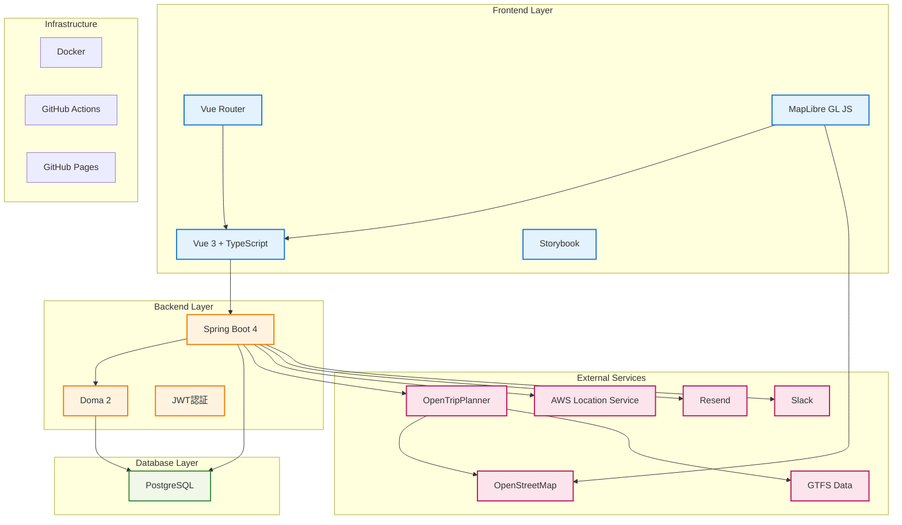

# 技術スタック

## アーキテクチャ概要



## フロントエンド

| 技術 | バージョン | 用途 |
|------|-----------|------|
| Vue.js | 3.x | UIフレームワーク |
| TypeScript | 5.x | 静的型付け |
| Vue Router | 5.x | SPAルーティング |
| Pinia | 4.x | 状態管理 |
| Axios | 1.x | HTTP通信クライアント |
| PrimeVue | 4.5.5 | UIコンポーネントライブラリ |
| MapLibre GL JS | 6.x | 地図表示 |
| ESLint + Prettier | - | コード品質管理 |
| Jest | 30.x | ユニットテスト |
| Playwright | 1.x | E2Eテスト |
| Storybook | 10.6.5 | コンポーネント開発・ドキュメント |
| Vite | 8.x | ビルドツール |
| vite-plugin-pwa | 2.x | PWA対応（Service Worker生成） |
| PrimeFlex / PrimeIcons | 4.x / 7.x | CSSユーティリティ・アイコン |
| Sass | 1.x | スタイルシート |
| npm | - | パッケージ管理 |

## バックエンド

| 技術 | バージョン | 用途 |
|------|-----------|------|
| Java | 21 (LTS) | 言語 |
| Spring Boot | 4.1.2 | Webフレームワーク |
| Doma 2 | 3.14.1 | O/Rマッパー |
| jjwt | 0.13.0 | JWT認証 |
| springdoc-openapi | 3.2.0 | OpenAPI仕様書（Swagger UI / ReDoc） |
| Resend Java SDK | 4.29.0 | パスワードリセットメール送信 |
| AWS SDK for Java v2 | 2.57.6 | AWS Location Service 連携 |
| Caffeine | - | キャッシュ |
| Apache Commons CSV | 1.14.1 | CSVインポート/エクスポート |
| Gradle | 9.8.2 | ビルドツール |

## データベース

| 技術 | バージョン | 用途 |
|------|-----------|------|
| PostgreSQL | 17.x（本番: Supabase）/ 18（Docker Compose・CI） | リレーショナルDB |

## 外部サービス

| 技術 | バージョン | 用途 |
|------|-----------|------|
| OpenTripPlanner | 2.5.0 | GTFS経路探索 |
| OpenStreetMap | - | 地図データ |
| AWS Location Service | - | ジオコーディング（住所・座標取得） |
| Resend | - | パスワードリセットメール送信 |
| Slack Incoming Webhook | - | フィードバック・特典情報報告の通知 |
| Nominatim（OpenStreetMap） | - | 出発地・目的地の地名検索、逆ジオコーディング（フロントエンドから直接呼び出し） |

## インフラ・ツール

| 技術 | バージョン | 用途 |
|------|-----------|------|
| Docker / Docker Compose | - | コンテナ化・開発環境統一 |
| GitHub Actions | - | CI/CD |
| CodeQL（Advanced setup） | - | 静的解析（セキュリティスキャン） |
| Dependabot | - | 依存関係の自動更新 |
| Docsify | 4.13.1 | ドキュメントホスティング（ビルド不要） |
| GitHub Pages | - | ドキュメントホスティング |

## ホスティング・本番環境

| サービス | 用途 | URL |
|----------|------|-----|
| Vercel | フロントエンドホスティング | `https://www.kumamoto-henno-map.com` |
| Render | バックエンド（Spring Boot）ホスティング | `https://api.kumamoto-henno-map.com` |
| Supabase | 本番データベース（PostgreSQL 17） | 外部接続（SSL必須） |
| Hetzner VPS | OpenTripPlannerサーバー（Nginx + SSL） | `https://otp.kumamoto-henno-map.com` |
| Cloudflare | ドメイン管理・DNS | `kumamoto-henno-map.com` |

### ドメイン構成

| サブドメイン | CNAME/A先 | 用途 |
|-------------|----------|------|
| `@` / `www` | Vercel | フロントエンド |
| `api` | Render（CNAME） | バックエンドAPI |
| `otp` | Hetzner VPS（Aレコード） | 経路探索エンジン |

### Vercel リライト設定

フロントエンドと同一オリジンからAPIを呼び出すため、Vercelのリライト機能でAPIプロキシを構成しています。

```
/kumamoto-henno-map/api/** → https://api.kumamoto-henno-map.com/kumamoto-henno-map/api/**
```

これにより Cookie（`SameSite=Lax`）が正常に送信され、クロスオリジン問題を回避しています。
