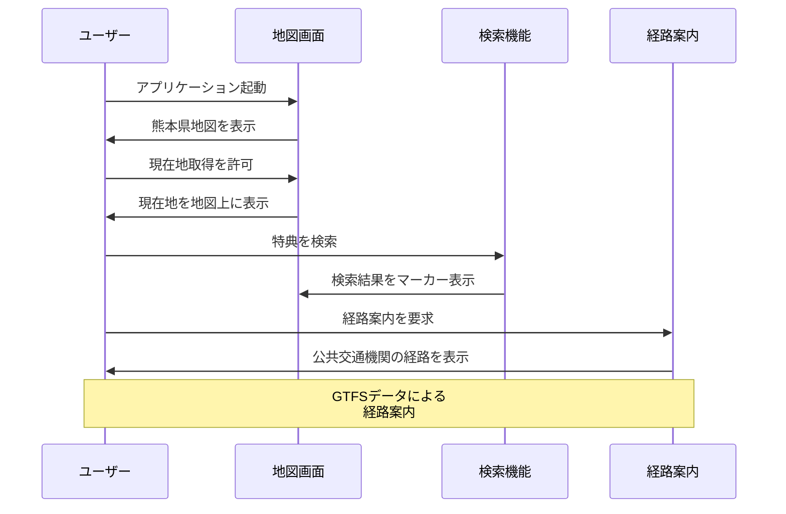

# 機能一覧

本システムで提供する全機能の一覧と詳細仕様を記載します。

## システム利用フロー

## 機能分類

### 1. 基本機能（エンドユーザー向け）

#### 1.1 地図表示・操作機能

| 機能ID | 機能名 | 概要 |
|--------|--------|------|
| F001 | 地図表示 | 熊本県の地図を表示し、特典提供施設をマーカーで表示 |
| F002 | 地図操作 | ズーム・パンなどの基本操作 |
| F003 | 現在地取得 | GPS情報による現在位置の取得と地図上での表示 |

#### 1.2 特典検索・絞り込み機能

| 機能ID | 機能名 | 概要 |
|--------|--------|------|
| F011 | キーワード検索 | 特典名・特典内容によるフリーワード検索 |
| F012 | カテゴリ絞り込み | 特典カテゴリ（交通・買い物等）による絞り込み |
| F013 | 地域絞り込み | 居住地域（自治体）による絞り込み |
| F014 | 条件別絞り込み | 年齢・運転免許の所持状況による絞り込み |
| F015 | 現在地からの距離絞り込み | スライダー（0〜10km、0は距離指定なし）で現在地からの距離を指定し、座標を持つ特典を絞り込み |

#### 1.3 特典情報表示機能

| 機能ID | 機能名 | 概要 |
|--------|--------|------|
| F021 | 特典詳細情報 | 特典の詳細内容・適用条件・有効期限の表示 |
| F022 | 施設情報表示 | 施設の基本情報・連絡先の表示 |
| F023 | 最終確認日表示 | 管理者が特典情報を最後に確認した日付を特典カードに表示。半年以上前は警告色、未設定時は「未確認」と表示 |
| F024 | 特典URL共有 | 特典カードの「URLをコピー」で `/?benefitId={id}` をクリップボードにコピー。URLを開くと該当特典を「シェアされた特典」として表示（ログイン不要） |
| F025 | 利用できる特典表示 | ログインユーザーのプロフィール（年齢・居住地域・運転免許の所持状況）に合致する特典を「利用できる特典」タブに表示 |

#### 1.4 経路案内機能

| 機能ID | 機能名 | 概要 |
|--------|--------|------|
| F031 | 公共交通経路探索 | GTFSデータを活用したバス・電車での経路案内 |
| F032 | 徒歩経路案内 | 最寄り駅・バス停からの徒歩ルート表示 |
| F033 | 所要時間・運賃表示 | 移動時間と交通費の計算・表示。運賃割引の特典がある区間は割引後運賃も表示 |
| F035 | 複数経路比較 | 複数の経路候補の比較表示 |
| F036 | 乗り換え案内 | 区間ごとの乗車・降車情報、乗り換え回数、リアルタイムの遅延情報の表示 |

#### 1.5 ユーザー管理機能

| 機能ID | 機能名 | 概要 |
|--------|--------|------|
| F041 | 会員登録 | 新規ユーザーの会員登録 |
| F042 | ログイン・ログアウト | ユーザー認証とセッション管理（アクセストークン1時間・リフレッシュトークン30日で自動更新） |
| F043 | プロフィール設定 | 生年月日・居住地域・運転免許の所持状況・返納日の設定。最終ログイン日時・IPアドレスの表示 |
| F044 | パスワード変更 | ログイン済みユーザーが現在のパスワードを確認した上で新パスワードに変更 |
| F045 | パスワードリセット | メールアドレスにリセット用URLを送信し、ワンタイムトークンで新パスワードを設定（トークン有効期限30分） |
| F046 | ログイン試行制限 | 連続ログイン失敗時にアカウントを一時ロックし、不正アクセスを防止する |
| F047 | 退会 | プロフィール画面からパスワードによる本人確認の上でアカウントを削除する（管理者アカウントは不可） |

#### 1.6 サポート・情報機能

| 機能ID | 機能名 | 概要 |
|--------|--------|------|
| F051 | ヘルプ・サポート情報 | 自主返納制度の説明と使い方ガイド |
| F061 | フィードバック送信 | ホーム画面のサイドバー下部「問い合わせ」ボタンからモーダルを開き、バグ報告・要望・その他のご意見をSlackに送信する |
| F062 | ライセンス・出典情報表示 | ホーム画面のサイドバー下部「ライセンス情報」ボタンからモーダルを開き、位置情報取得方針・OSSライセンス・オープンデータ出典を確認する |
| F063 | 特典情報の誤り報告 | 特典カードの「情報を報告」ボタンから、確認ダイアログを経て特典情報の誤りをSlackに通知する |

### 2. 外部連携機能

#### 2.1 データ連携機能

| 機能ID | 機能名 | 概要 |
|--------|--------|------|
| E001 | GTFS連携 | 公共交通データとの連携（GitHub Actions で毎週有効期限をチェックし自動更新） |
| E002 | OpenStreetMap連携 | 地図・道路データとの連携 |
| E003 | 自治体データ連携 | 各自治体の特典データ取り込み |

### 3. 管理機能（管理者向け）

管理者アカウント（`ROLE_ADMIN`）でログイン後に利用可能な機能。各管理機能は一覧表示・新規作成・更新・削除の基本CRUD操作、CSVによる一括インポート、一覧のCSVエクスポートを提供する（ユーザー管理は新規作成・CSVインポートなし）。一覧画面では複数行を選択して一括削除できる。

#### 3.1 特典管理

| 機能ID | 機能名 | 概要 |
|--------|--------|------|
| A001-1 | 特典一覧表示 | キーワード・自治体・カテゴリ等で絞り込んだ特典の一覧をページング表示 |
| A001-2 | 特典新規作成 | 特典情報の新規登録 |
| A001-3 | 特典更新 | 登録済み特典情報の編集・保存 |
| A001-4 | 特典削除 | 特典の削除 |
| A001-5 | 特典CSVインポート | CSVファイルによる特典の一括登録・更新 |
| A001-6 | 特典座標取得 | AWS Location Serviceを使用して店舗特典（BS001）の店舗名から住所・緯度・経度を一括取得・保存 |
| A001-7 | 特典確認済み更新 | 「確認済み」ボタンで特典の最終確認日を当日の日付に更新 |

#### 3.2 特典条件管理

| 機能ID | 機能名 | 概要 |
|--------|--------|------|
| A002-1 | 特典条件一覧表示 | 特典ID・免許状況・年齢等で絞り込んだ利用条件の一覧をページング表示 |
| A002-2 | 特典条件新規作成 | 利用条件の新規登録 |
| A002-3 | 特典条件更新 | 登録済み利用条件の編集・保存 |
| A002-4 | 特典条件削除 | 利用条件の削除 |
| A002-5 | 特典条件CSVインポート | CSVファイルによる利用条件の一括登録・更新 |

#### 3.3 特典種別管理

| 機能ID | 機能名 | 概要 |
|--------|--------|------|
| A003-1 | 特典種別一覧表示 | カテゴリコード・名称等で絞り込んだ特典カテゴリの一覧をページング表示 |
| A003-2 | 特典種別新規作成 | 特典カテゴリの新規登録 |
| A003-3 | 特典種別更新 | 登録済みカテゴリの編集・保存 |
| A003-4 | 特典種別削除 | カテゴリの削除 |
| A003-5 | 特典種別CSVインポート | CSVファイルによるカテゴリの一括登録・更新 |

#### 3.4 自治体管理

| 機能ID | 機能名 | 概要 |
|--------|--------|------|
| A004-1 | 自治体一覧表示 | 自治体コード・名称・種別等で絞り込んだ自治体の一覧をページング表示 |
| A004-2 | 自治体新規作成 | 自治体情報の新規登録 |
| A004-3 | 自治体更新 | 登録済み自治体情報の編集・保存 |
| A004-4 | 自治体削除 | 自治体の削除 |
| A004-5 | 自治体CSVインポート | CSVファイルによる自治体の一括登録・更新 |

#### 3.5 事業者管理

| 機能ID | 機能名 | 概要 |
|--------|--------|------|
| A005-1 | 事業者一覧表示 | 事業者名・かな・電話番号等で絞り込んだ交通事業者の一覧をページング表示 |
| A005-2 | 事業者新規作成 | 交通事業者情報の新規登録 |
| A005-3 | 事業者更新 | 登録済み事業者情報の編集・保存 |
| A005-4 | 事業者削除 | 事業者の削除 |
| A005-5 | 事業者CSVインポート | CSVファイルによる事業者の一括登録・更新 |

#### 3.6 運賃割引管理

| 機能ID | 機能名 | 概要 |
|--------|--------|------|
| A006-1 | 運賃割引一覧表示 | 特典ID・事業者ID・割引種別等で絞り込んだ運賃割引の一覧をページング表示 |
| A006-2 | 運賃割引新規作成 | 運賃割引情報の新規登録 |
| A006-3 | 運賃割引更新 | 登録済み運賃割引情報の編集・保存 |
| A006-4 | 運賃割引削除 | 運賃割引の削除 |
| A006-5 | 運賃割引CSVインポート | CSVファイルによる運賃割引の一括登録・更新 |

#### 3.7 コミュニティバス路線管理

| 機能ID | 機能名 | 概要 |
|--------|--------|------|
| A007-1 | コミュニティバス路線一覧表示 | 路線名・路線ID等で絞り込んだコミュニティバス路線の一覧をページング表示 |
| A007-2 | コミュニティバス路線新規作成 | コミュニティバス路線情報の新規登録 |
| A007-3 | コミュニティバス路線更新 | 登録済み路線情報の編集・保存 |
| A007-4 | コミュニティバス路線削除 | コミュニティバス路線の削除 |
| A007-5 | コミュニティバス路線CSVインポート | CSVファイルによる路線の一括登録・更新 |

#### 3.8 ユーザー管理

| 機能ID | 機能名 | 概要 |
|--------|--------|------|
| A008-1 | ユーザー一覧表示 | ユーザー名・メール・自治体・免許状況等で絞り込んだユーザーの一覧をページング表示 |
| A008-2 | ユーザー詳細表示 | 特定ユーザーの詳細情報表示 |
| A008-3 | ユーザー更新 | ユーザー情報の編集・保存（管理者権限） |
| A008-4 | ユーザー削除 | ユーザーアカウントの削除 |
| A008-5 | ユーザーCSVエクスポート | ユーザー一覧のCSV出力 |

## 機能別詳細仕様

### F001: 地図表示

**概要**: 熊本県全域の地図を表示し、特典提供施設をマーカーで表示する基本機能

**詳細仕様**:
- **地図エンジン**: MapLibre GL JS
- **地図データ**: OpenStreetMap
- **地図タイル**: `tile.openstreetmap.jp`（osm-bright-ja スタイル）
- **初期表示**: 熊本市中心部（経度 130.741584, 緯度 32.7898）、ズームレベル14
- **表示可能範囲**: 熊本県周辺に制限（経度 128.52-132.33, 緯度 30.90-34.06）
- **ズームレベル**: 8-18（県全域～建物レベル）
- **マーカー表示**: 特典カテゴリ別アイコン
- **店舗マーカー表示切替**: 地図右上のトグルスイッチ（`pi pi-shop` アイコン + 「店舗」ラベル）で、座標を持つ店舗特典（カテゴリ: BS001）のマーカー表示/非表示を切り替え可能
  - ON: `GET /benefit/markers` で座標付き店舗特典を全件取得しマーカー表示
  - OFF: 全ての店舗マーカーを削除
  - マーカークリック時: ポップアップで特典名・内容・電話番号・住所・詳細URLを表示
  - 検索結果との連動: 特典検索で座標付き結果がある場合、検索結果のマーカーを地図に表示
- **レスポンシブ対応**: スマートフォン・タブレット・PC対応

**入力**: なし
**出力**: 地図画面、特典マーカー
**前提条件**: インターネット接続
**例外処理**: 位置情報取得失敗時は初期表示位置（熊本市中心部）のまま表示

### F011: キーワード検索

**概要**: 特典名・特典内容によるフリーワード検索機能（「特典を探す」タブ）

**詳細仕様**:
- **検索対象フィールド**: 特典名、特典内容
- **検索方式**: 部分一致（LIKE検索）
- **他の検索条件との組み合わせ**: カテゴリ（F012）、居住地域（F013）、年齢・運転免許の所持状況（F014）、現在地からの距離（F015）とAND条件で組み合わせ可能
- **検索結果**: 件数上限なし。カテゴリごとにグループ化して表示
- **API**: `POST /benefit/search`

**入力**: 検索キーワード（文字列・任意）
**出力**: 検索結果リスト
**前提条件**: なし（全条件未入力の場合は全特典を返す）
**例外処理**: 結果が0件の場合は「条件に一致する特典がありません」メッセージ表示

### F046: ログイン試行制限

**概要**: 短時間に連続してログインに失敗した場合、アカウントを一時的にロックし不正アクセスを防止する機能

**詳細仕様**:
- **実装クラス**: `LoginAttemptService`（Caffeineキャッシュによるメモリ内管理）
- **ログイン失敗制限**: 10回連続失敗で15分間ロック
- **新規登録制限**: 5回試行で60分間ロック
- **パスワードリセット制限**: リセット要求・リセット実行それぞれ5回試行で15分間ロック
- **退会時のパスワード照合制限**: 5回失敗で15分間ロック（ユーザー単位）
- **ロック中の挙動**: ロック状態への試行は即時拒否（HTTP 429）
- **自動解除**: ロック時間経過後に自動解除
- **実装上の注意**: 単一インスタンス前提。水平スケーリング時はRedis等の共有ストアへの移行が必要

**入力**: なし（F042 ログイン・F041 会員登録・F045 パスワードリセット・F047 退会に透過的に組み込み）
**出力**: ロック中は HTTP 429 レスポンス
**前提条件**: F042（ログイン・ログアウト）機能の一部
**例外処理**: ロック判定はサーバーサイドで実施

---

### F061: フィードバック送信

**概要**: ホーム画面のサイドバー下部にある「問い合わせ」ボタンからモーダルダイアログを開き、バグ報告・要望・その他のカテゴリで意見を送信する機能

**詳細仕様**:
- **アクセス**: ホーム画面のサイドバー下部「問い合わせ」ボタン（`pi pi-envelope` アイコン）
- **認証**: 不要（未ログインユーザーも送信可）
- **入力項目**:
  - カテゴリ（必須）: バグ報告 / 要望 / その他
  - お名前（任意）: ログイン済みの場合はユーザー名を初期値として自動入力
  - メールアドレス（任意）: ログイン済みの場合はメールアドレスを初期値として自動入力
  - 内容（必須）: 最大2000文字（お名前は最大100文字、メールアドレスは最大255文字。文字数上限は画面側で制御）
- **送信先**: バックエンド経由でSlack Incoming Webhookに通知
- **Slack通知フォーマット**: カテゴリ・お名前・メールアドレス・内容・送信日時・ユーザー情報（ログイン済み/未ログイン）を含む
- **Webhook URL未設定時**: Slack送信をスキップしてサーバーログにのみ出力（サイレント処理）

**入力**: カテゴリ、お名前（任意）、メールアドレス（任意）、内容
**出力**: 送信完了メッセージ（モーダル内）
**前提条件**: 内容フィールドに1文字以上の入力
**例外処理**: サーバーエラー時はモーダル内にエラーメッセージを表示（Slack送信自体の失敗はサーバーログのみ出力し、送信完了扱い）

---

### F062: ライセンス・出典情報表示

**概要**: ホーム画面のサイドバー下部にある「ライセンス情報」ボタンからモーダルダイアログを開き、位置情報取得方針・OSSライセンス・オープンデータ出典を確認する機能

**詳細仕様**:
- **アクセス**: ホーム画面のサイドバー下部「ライセンス情報」ボタン（`pi pi-info-circle` アイコン）
- **表示内容**:
  - 位置情報の取得について（ルート計算のみに使用・サーバー保存なし）
  - 自主返納特典の出典（熊本県公式サイト）
  - OSS ライセンス情報（OpenTripPlanner 2.5.0 / Apache License 2.0 / GNU LGPL v3）
  - オープンデータ出典（バスきたくまさん CC BY 4.0、熊本市交通局 CC BY 2.1 JP、熊本電鉄 CC0 1.0）
- **リンク**: 関連URLはすべて新規タブで開く（`noopener,noreferrer`）

**入力**: なし
**出力**: モーダルダイアログ（スクロール可能）
**前提条件**: なし

---

### F031: 公共交通経路探索

**概要**: GTFSデータを活用した公共交通機関での経路案内

**詳細仕様**:
- **連携システム**: OpenTripPlanner 2.5.0
- **対応交通手段**: 公共交通機関、電車、バス、徒歩、自転車（選択式）
- **出発地・目的地の入力**: 地名検索（Nominatim）による候補選択、または現在地ボタンによる現在地の設定
- **時刻指定**: 出発時刻指定・到着時刻指定を切り替え可能（日付・時刻は任意）
- **経路候補**: 到着時刻の早い順に最大3件
- **結果表示**: 地図上の経路線、出発・到着時刻、所要時間、運賃（割引後運賃）、乗り換え回数、区間ごとの詳細、リアルタイムの遅延情報
- **更新頻度**: GTFSデータは毎週有効期限をチェックし、必要に応じて自動更新
- **API**: `POST /route/search`

**入力**: 交通手段、出発地、目的地、出発/到着、日付、時刻
**出力**: 経路候補リスト
**前提条件**: 有効な出発地・目的地の指定
**例外処理**: 経路が見つからない場合は「経路が見つかりませんでした」メッセージを表示

---

### F063: 特典情報の誤り報告

**概要**: 特典カードの「情報を報告」ボタンから、特典情報の誤り（情報が古い等）を管理者に報告する機能

**詳細仕様**:
- **アクセス**: 「特典を探す」タブ・「利用できる特典」タブの特典カードにある「情報を報告」ボタン
- **認証**: 不要
- **操作**: 確認ダイアログで報告を確定
- **送信先**: バックエンド経由でSlack Incoming Webhookに通知（特典名・特典ID・報告日時）
- **API**: `POST /benefit/{benefitId}/report`

**入力**: 特典ID
**出力**: 送信完了メッセージ
**前提条件**: 報告対象の特典が存在すること
**例外処理**: 送信失敗時はエラーメッセージを表示
