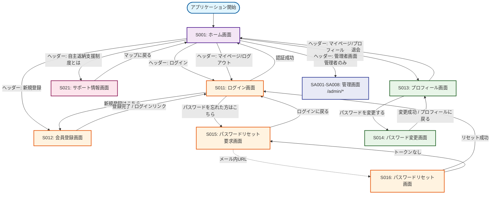
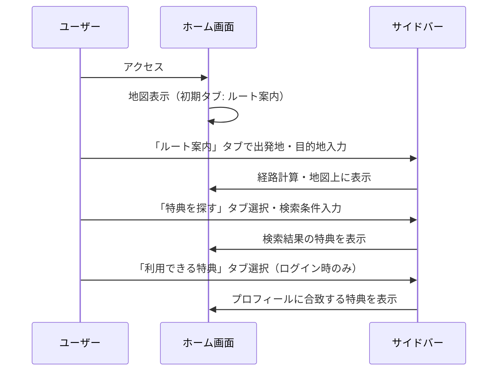
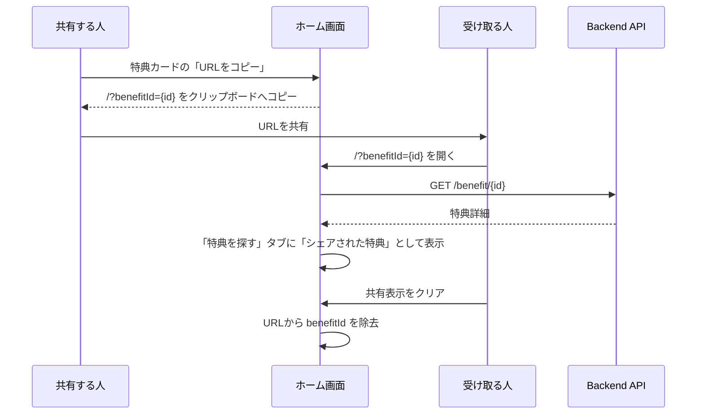
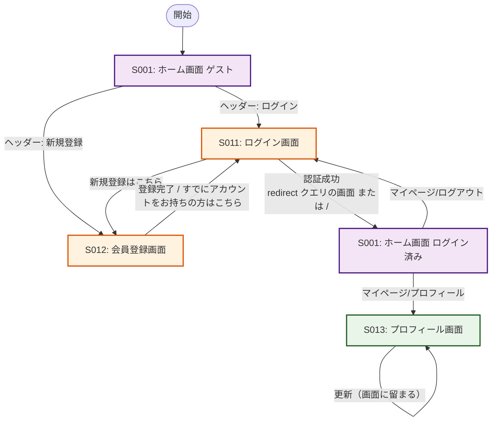
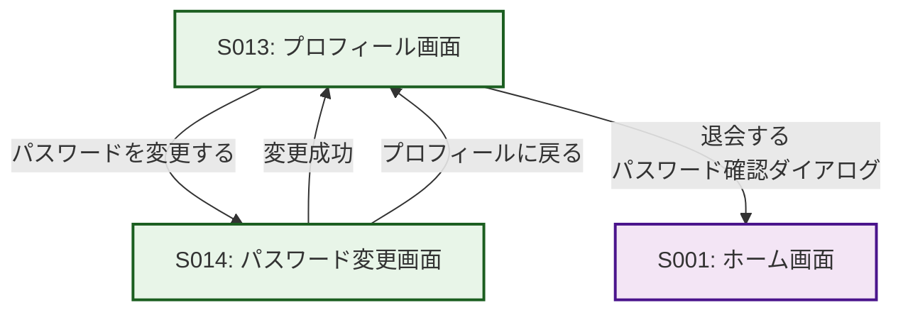
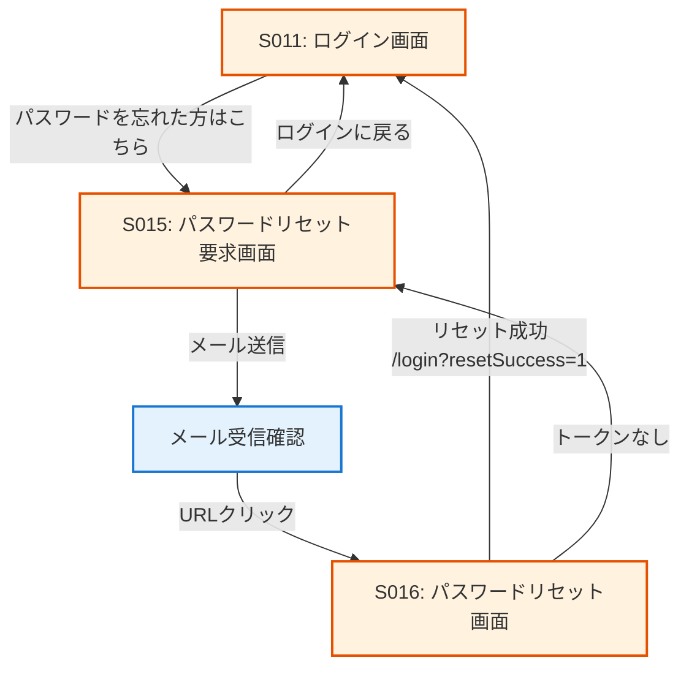
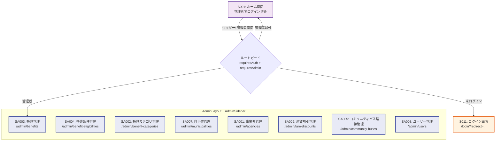
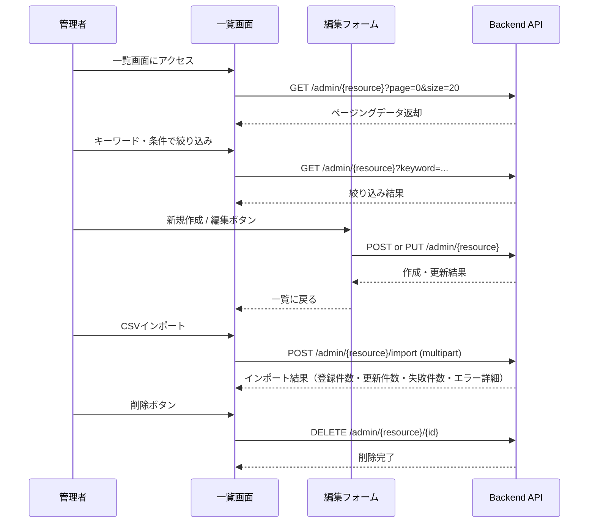

# 画面遷移図

本システムの画面間の遷移フローと操作の流れを図示します。

## 全体画面遷移図

ヘッダー（`AppHeader`）は全画面共通で表示され、「ホーム」「自主返納支援制度とは」のほか、ログイン状態・権限に応じたメニューを表示する。

> ヘッダーのメニューはホーム画面以外の全画面（管理画面を含む）でも同様に利用できる。図ではホーム画面からの遷移のみ記載している。

## エンドユーザー向けフロー詳細

### 1. 基本利用フロー（未登録ユーザー）

### 2. 特典共有URLフロー（ログイン不要）

### 3. 会員登録・ログインフロー

### 4. パスワード変更・退会フロー（ログイン済みユーザー）

> 管理者アカウントには「退会する」リンクを表示しない。

### 5. パスワードリセットフロー（未ログインユーザー）

## 管理者向けフロー詳細

### 6. 管理画面への遷移フロー

管理画面は共通レイアウト（`AdminLayout`）のサイドバー（`AdminSidebar`）で相互に遷移する。

> サイドバーの並び順は図の subgraph 内の順序と同じ。サイドバーから全管理画面へ相互に遷移できる（図では省略）。

### 7. 管理画面共通操作フロー

- ユーザー管理（`/admin/users`）は新規作成・CSVインポートを持たず、一覧・詳細・更新・削除のみ。
- 特典管理（`/admin/benefits`）は、座標一括取得（`POST /admin/benefits/geocode`）と確認済み更新（`POST /admin/benefits/{benefitId}/confirm`）も持つ。
- 運賃割引の更新・削除は複合キー（`/admin/fare-discounts/{benefitId}/{agencyId}`）を使用する。

---

## 画面遷移の詳細仕様

### 遷移方法の種類

| 遷移方法 | 説明 | 実装方式 | 使用場面 |
|----------|------|----------|----------|
| ページ遷移 | 新しい画面に完全移行 | Vue Router | メイン機能間の移動 |
| モーダル表示 | 現在画面の上にオーバーレイ | `AppDialog`（PrimeVue Dialog） | 確認ダイアログ、フィードバック、ライセンス表示 |
| タブ切り替え | 同一画面内のコンテンツ変更 | `AppTab`（PrimeVue Tabs） | ホーム画面のサイドバー（ルート案内・利用できる特典・特典を探す） |

### 認証が必要な画面

**認証必要画面**（未ログイン時は `/login?redirect=...` にリダイレクト）:
- S013: プロフィール画面
- S014: パスワード変更画面

**管理者権限が必要な画面**（未ログイン時は `/login?redirect=...`、管理者以外は `/` にリダイレクト）:
- SA001-SA008: 管理画面（`/admin/*`）

**パブリック画面**:
- S001: ホーム画面（ゲスト利用可能。共有URL `/?benefitId={id}` もログイン不要）
- S011: ログイン画面（ログイン済みの場合は `/` にリダイレクト）
- S012: 会員登録画面
- S015: パスワードリセット要求画面
- S016: パスワードリセット画面
- S021: サポート情報画面
